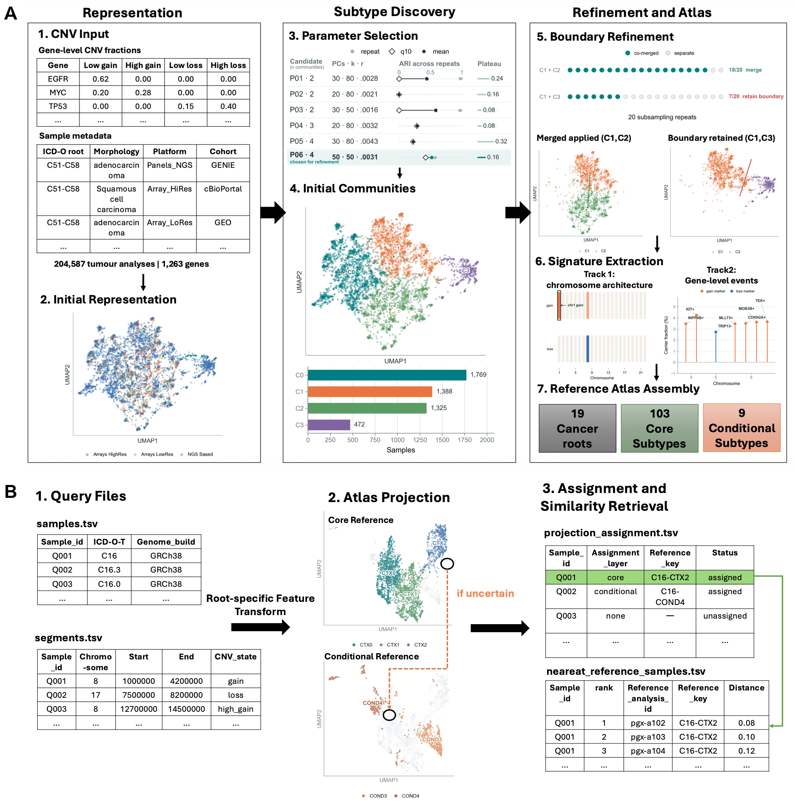
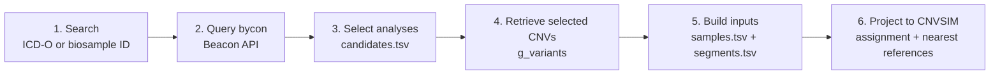

# CNVSIM

CNVSIM is a pan-cancer reference atlas of recurrent copy-number variation
(CNV) patterns and a Python workflow for assigning new CNV profiles to
calibrated cancer-specific subtypes. Version 1.0.0 contains 204,587 tumour
analyses across 19 cancer-root spaces, comprising 103 core subtypes and 9
conditional subtypes.

Panel A below summarizes atlas construction: gene-level CNV profiles are
represented in root-specific comparison spaces, partitioned into candidate
communities, refined through repeated subsampling, and annotated with Track 1
chromosome-scale signatures and Track 2 enriched gene-level signatures. Panel B
shows the user-facing projection workflow, in which new GRCh38 CNV segments
are transformed into the appropriate root-specific reference space, evaluated
first against core subtypes and, when needed, against an eligible conditional
layer, and linked to their nearest reference tumour analyses.

Building on this frozen reference, the public workflows support two main use
cases:

- project a new tumour or cell-line CNV profile into the frozen CNVSIM atlas;
- query ranked Cellosaurus cell lines for a CNVSIM subtype, or identify the
  matched tumour-derived reference subtype for a specified cell line.

<p align="center">
  <a href="docs/assets/cnvsim_workflow.png">
    
  </a>
</p>

<p align="center"><em>CNVSIM atlas construction and projection workflow.</em></p>

## Code and data

This repository contains the CNVSIM source code, configuration files,
validation workflows, and manuscript figure runners. The frozen atlas,
projection bundle, validation summaries, source data, and cell-line catalogue
are distributed separately as the **CNVSIM Atlas v1.0.0 data release**.

- Code: <https://github.com/baudisgroup/CNVSIM>
- Data release: **[Zenodo DOI to be added before release]**

After downloading and extracting the data release, define its location:

```bash
export CNVSIM_DATA=/path/to/CNVSIM_v1.0.0_public
```

The data release includes its own README with an embedded data dictionary and manifests.

## Installation

Clone the repository and create the frozen Conda environment (recommended):

```bash
git clone https://github.com/baudisgroup/CNVSIM.git
cd CNVSIM
conda env create -f environment.yml
conda activate cnvsim
```

If Conda is not available, use Python 3.10 and a standard virtual environment.
The pip requirements mirror the Python package versions in `environment.yml`:

```bash
git clone https://github.com/baudisgroup/CNVSIM.git
cd CNVSIM
python3.10 -m venv .venv
source .venv/bin/activate
python -m pip install --upgrade pip
python -m pip install -r requirements.txt
```

On Windows, activate the environment with `.venv\Scripts\activate` instead.

## Project new CNV profiles

The public projection interface accepts one metadata table and one CNV segment
table. Multiple samples may be submitted together.

### Input requirements

- genome build: GRCh38/hg38;
- coordinates: 0-based, half-open intervals;
- chromosomes: autosomes 1-22;
- one cancer-root identifier or ICD-O topography code per sample;
- CNV segments labelled as gain, loss, high-level gain, or high-level loss.

CNVSIM uses the supplied topography to select a root-specific reference space.

### `samples.tsv`

The table requires `sample_id` and one of `root`, `icdot_root_grouped`, or
`icdo_topography_id`. `genome_build` is optional but, when present, must be
`GRCh38` or `hg38`.

```text
sample_id	icdo_topography_id	genome_build
Q001	C16.9	GRCh38
Q002	C18.7	GRCh38
Q003	C44.5	GRCh38
```

### `segments.tsv`

The required columns are `sample_id`, `chromosome`, `start`, `end`, and
`cnv_state`. The state labels are required as `gain`, `loss`, `high_gain`, and
`high_loss`.

```text
sample_id	chromosome	start	end	cnv_state
Q001	8	1000000	4200000	gain
Q001	17	7500000	8200000	loss
Q002	8	12700000	14500000	high_gain
```

### Run projection

```bash
python -m run_scripts.project_samples \
  --bundle-dir "$CNVSIM_DATA/projection_bundle" \
  --samples /path/to/samples.tsv \
  --segments /path/to/segments.tsv \
  --out-dir /path/to/projection_results \
  --overwrite
```

### Projection outputs

| File | Contents |
|---|---|
| `projection_assignments.tsv` | **Start here.** One row per query sample reporting whether it received a confident assignment, the matched subtype, and whether that subtype came from the core or conditional reference layer. Samples that do not pass the calibrated criteria are reported as ambiguous or unresolved. |
| `projection_candidates.tsv` | The alternative subtypes considered for each sample, ordered by their projection rank. |
| `nearest_reference_samples.tsv` | The individual atlas tumour analyses most similar to each query, ranked from smallest to largest distance. |
| `query_coordinates.parquet` | The numerical position of each query in its root-specific comparison space. This file is mainly intended for visualization and technical audit. |
| `projection_manifest.json` | A record of the input files, projection bundle, generated outputs, and assignment counts for reproducibility. |

**Core subtypes** are stable communities recovered during atlas discovery and
use `CTX` reference identifiers, such as `C16-CTX2`. Every query is evaluated
against the core layer first. **Conditional subtypes** passed repeated
fixed-label validation, use `COND` identifiers such as `C16-COND4`, and are
considered only when the core result is ambiguous or unresolved and the root
has an eligible conditional reference. The complete subtype catalogue and its
enriched Track 1 chromosome-scale and Track 2 gene-level signatures are
available under `atlas/` in the data release.

## Retrieve and project a Progenetix example

The test module can query projectable tumour or cancer cell-line CNV analyses
from the public Progenetix/bycon Beacon API and convert selected analyses into
the two CNVSIM input tables.



Start by listing candidate analyses; this example uses stomach topography and
includes descendant ICD-O terms:

```bash
export EXAMPLE_OUT=/path/to/progenetix_example

python tests/progenetix_retrieval_example/query_candidates.py \
  --resource tumour \
  --filter pgx:icdot-C16 \
  --include-descendants \
  --limit 20 \
  --release-dir "$CNVSIM_DATA" \
  --out "$EXAMPLE_OUT/candidates.tsv" \
  --overwrite
```

Review `candidates.tsv` and enter `yes` in the `selected` column for one or
more analyses. The overlap columns report whether an analysis is already part
of the released atlas; they are informational and do not prevent projection.
Convert the selected rows and run the standard projection interface:

```bash
python tests/progenetix_retrieval_example/prepare_projection_inputs.py \
  --selection "$EXAMPLE_OUT/candidates.tsv" \
  --out-dir "$EXAMPLE_OUT/input" \
  --overwrite

python -m run_scripts.project_samples \
  --bundle-dir "$CNVSIM_DATA/projection_bundle" \
  --samples "$EXAMPLE_OUT/input/samples.tsv" \
  --segments "$EXAMPLE_OUT/input/segments.tsv" \
  --out-dir "$EXAMPLE_OUT/projection" \
  --overwrite
```

Use `--resource cell-line` to query the cancercelllines dataset, or one or more
`--biosample-id` arguments to retrieve specified biosamples directly.

For example, the following command retrieves CNV analyses for two specified
Progenetix tumour biosamples without running a topography filter:

```bash
python tests/progenetix_retrieval_example/query_candidates.py \
  --resource tumour \
  --biosample-id pgxbs-kftviyx8 \
  --biosample-id pgxbs-kftvk2uk \
  --release-dir "$CNVSIM_DATA" \
  --out "$EXAMPLE_OUT/selected_biosamples.tsv" \
  --overwrite
```

The helper sends HTTP `GET` requests
to the [bycon-powered Progenetix Beacon v2
API](https://docs.progenetix.org/common/beacon-api/) using these endpoint
patterns:

- `/beacon/biosamples?filters=...` finds currently retrievable biosamples;
- `/beacon/biosamples/{biosample_id}/analyses?limit=0` lists their analyses;
- `/beacon/biosamples/{biosample_id}/g_variants?limit=0` retrieves CNV records.

For an exact biosample query, the first request instead uses
`/beacon/biosamples?biosampleIds=...`. Cell-line requests additionally set
`datasetIds=cellz`. The converter keeps only GRCh38 CNV records on chromosomes
1-22. If a biosample has multiple analyses, it uses
`caseLevelData.analysisId` to assign each CNV to the selected analysis and
prevents profiles from different analyses from being mixed.

### Projection smoke test

The test retrieves three fixed public Progenetix analyses
and verifies core assignment, conditional routing, unresolved handling,
nearest-reference output:

```bash
CNVSIM_DATA="$CNVSIM_DATA" \
CNVSIM_RUN_NETWORK_TESTS=1 \
python -m unittest tests.progenetix_retrieval_example.test_projection -v
```

The test will write to a temporary directory.

## Query Cellosaurus cell lines

The public cell-line resource contains 4,605 CNV analysis profiles
representing 1,704 Cellosaurus cell lines. A profile is one Progenetix
CNV analysis. A cell line may have multiple profiles and may occur in more than
one cancer-root group.

### Find recommended cell lines for a subtype

```bash
python run_scripts/applications/query_experimental_models.py \
  --cell-line-dir "$CNVSIM_DATA/cell_line" \
  --reference-key C16-COND4 \
  --top-n 5
```

### Look up the tumour-derived reference subtype for a cell line

```bash
python run_scripts/applications/query_experimental_models.py \
  --cell-line-dir "$CNVSIM_DATA/cell_line" \
  --model-id CVCL_7042 \
  --include-analysis-details
```

Use `--out` to save the full main result as TSV and `--analysis-out` to save
analysis-level details for a cell-line lookup. Recommended models are ranked by
replicate evidence, assignment consistency and coverage, and calibrated
distance to the matched subtype.

## Repository layout

| Path | Purpose |
|---|---|
| `cnvsim/` | Core preprocessing, atlas construction, projection, validation, and cell-line query modules. |
| `configs/` | Analysis and validation configurations. |
| `run_scripts/project_samples.py` | Projection entry point for new CNV segments. |
| `run_scripts/applications/` | Cell-line resource query interface. |
| `run_scripts/analysis/` | Atlas construction and reference-projection workflows. |
| `run_scripts/validation/` | Projection and signature-recovery validation runners. |
| `run_scripts/figures/` | Runners used to produce manuscript figures. |
| `tests/progenetix_retrieval_example/` | Public bycon retrieval example and live projection smoke test. |

## Citation

If you use CNVSIM, please cite both the manuscript and the versioned data
release:

- Manuscript: **[citation to be added]**
- Data release: **[Zenodo DOI to be added]**

### External resources used by CNVSIM

- **Progenetix** — source of the harmonized tumour and cancer cell-line CNV
  profiles and associated metadata used to construct the atlas and cell-line
  catalogue, and host of the bycon-powered Beacon API used by the retrieval
  example. Huang Q, Carrio-Cordo P, Gao B, Paloots R, Baudis M. [The
  Progenetix oncogenomic resource in
  2021](https://doi.org/10.1093/database/baab043). *Database*. 2021;2021:baab043.
- **cancercelllines.org** — description of the curated cancer cell-line
  genomic resource supporting the CNVSIM cell-line use case. Paloots R,
  Baudis M. [cancercelllines.org—a novel resource for genomic variants in
  cancer cell lines](https://doi.org/10.1093/database/baae030). *Database*.
  2024;2024:baae030.
- **Cellosaurus** — source of the standardized cell-line names and accessions
  used to consolidate profiles and support model lookup. Bairoch A. [The
  Cellosaurus, a Cell-Line Knowledge
  Resource](https://doi.org/10.7171/jbt.18-2902-002). *J Biomol Tech*.
  2018;29:25–38.
- **OncoKB** — one of the two curated cancer-gene resources used to define the
  CNVSIM gene feature catalogue. Chakravarty D *et al.* [OncoKB: A Precision
  Oncology Knowledge Base](https://doi.org/10.1200/PO.17.00011). *JCO Precis
  Oncol*. 2017;1:1–16.
- **COSMIC Cancer Gene Census (CGC)** — the second curated cancer-gene resource
  used to define the CNVSIM gene feature catalogue. Sondka Z *et al.* [The
  COSMIC Cancer Gene Census: describing genetic dysfunction across all human
  cancers](https://doi.org/10.1038/s41568-018-0060-1). *Nat Rev Cancer*.
  2018;18:696–705.

## License

Original CNVSIM materials in this repository are licensed under the [Creative
Commons Attribution 4.0 International License (CC BY
4.0)](https://creativecommons.org/licenses/by/4.0/), unless otherwise noted.
This license permits sharing and adaptation, including commercial use, provided
that appropriate credit is given, the license is linked, and any changes are
indicated.

When reusing CNVSIM, please cite the CNVSIM manuscript and the versioned data
release, retain a link to the CC BY 4.0 license, and state whether the material
was modified. Third-party resources referenced or incorporated by CNVSIM remain
subject to their original licenses and terms of use. See [`LICENSE`](LICENSE),
or the [official online legal
code](https://creativecommons.org/licenses/by/4.0/legalcode.en), for the complete
terms.

## Contact

For software problems or questions about the public interfaces, open an issue
at <https://github.com/baudisgroup/CNVSIM/issues>.
