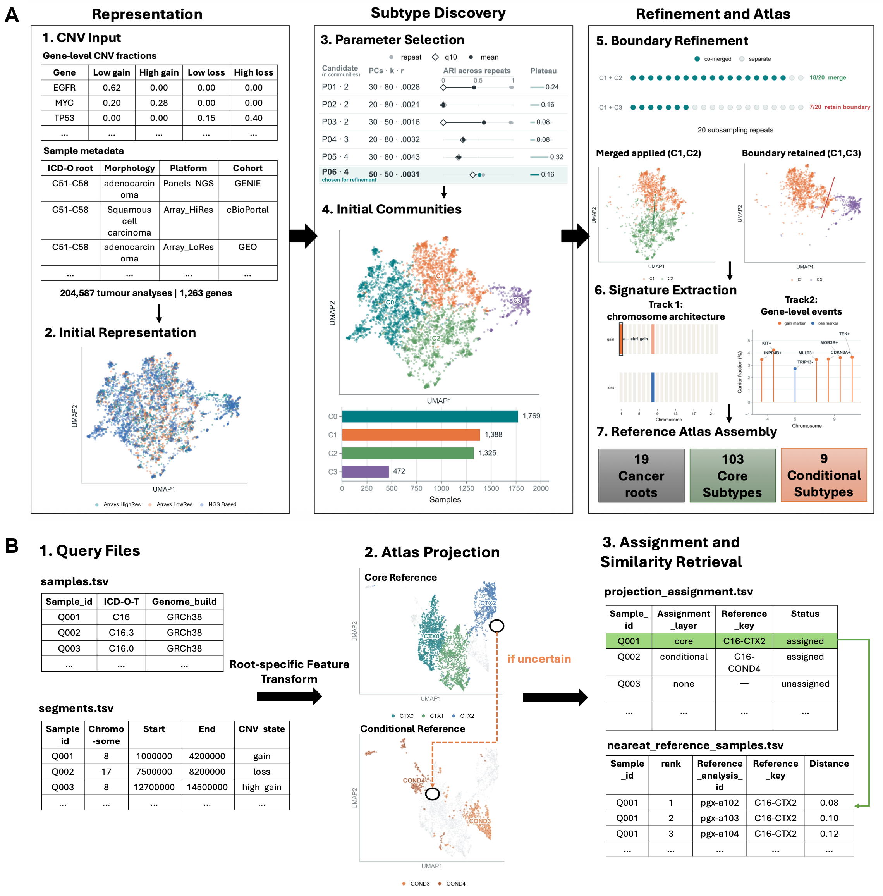
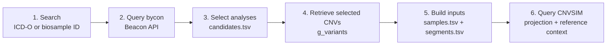

# CNVSIM

CNVSIM is a pan-cancer reference atlas of recurrent copy-number variation
(CNV) patterns and a Python workflow for assigning new CNV profiles to
calibrated cancer-specific subtypes. Version 1.0.1 contains 204,587 neoplastic
analyses across 19 cancer-root spaces, comprising 103 core subtypes and 9
conditional subtypes, together with tumour mutation-context summaries.

Panel A below summarizes atlas construction: gene-level CNV profiles are
represented in root-specific comparison spaces, partitioned into candidate
communities, refined through repeated subsampling, and annotated with Track 1
chromosome-scale signatures and Track 2 enriched gene-level signatures. Panel B
shows the user-facing projection workflow, in which new GRCh38 CNV segments
are transformed into the appropriate root-specific reference space, evaluated
first against core subtypes and, when needed, against an eligible conditional
layer, and linked to their nearest reference neoplastic analyses.

Building on this frozen reference, the public workflows support three main
application use cases:

- project a CNV profile from a new neoplastic sample or cell line into the
  frozen CNVSIM atlas;
- run an integrated reference-context query that projects new CNV profiles and
  retrieves the matched reference subtype cohort, subtype CNV signatures,
  ranked Cellosaurus cell-line candidates with multi-profile signature evidence,
  and within-diagnosis tumour mutation-context associations;
- query ranked Cellosaurus cell lines for a CNVSIM subtype, or identify the
  matched reference subtype, derived from neoplastic samples, for a specified
  cell line.

<p align="center">
  <a href="docs/assets/cnvsim_workflow.png">
    
  </a>
</p>

<p align="center"><em>CNVSIM atlas construction and projection workflow.</em></p>

## Preprint

The manuscript describing CNVSIM is available as a preprint on [bioRxiv](https://www.biorxiv.org/content/10.64898/2026.10.26.761332v1).

## Code and data

This repository contains the CNVSIM source code, configuration files,
validation workflows, and manuscript figure runners. The frozen atlas,
projection bundle, validation summaries, source data, and cell-line catalogue
are distributed separately as the **CNVSIM Atlas data release**:

- Code: <https://github.com/baudisgroup/CNVSIM>
- Data releases (all versions): <https://doi.org/10.5281/zenodo.23642833>
- Previous data release (v1.0.0): <https://doi.org/10.5281/zenodo.23642834>
- v1.0.1 data release (`CNVSIM_v1.0.1_public`): <https://doi.org/10.5281/zenodo.23982370>. Includes
  `cell_line/signature_evidence/`, `validation/mutation_context/`,
  `validation/source_holdout/`, and updated `supplementary/` files.

After extracting the data release, define its location:

```bash
export CNVSIM_DATA=/path/to/CNVSIM_v1.0.1_public
```

Standalone projection (`run_scripts/project_samples.py`) and direct Cellosaurus
catalogue queries (`run_scripts/applications/query_experimental_models.py`) also
work with `CNVSIM_v1.0.0_public`. The integrated reference-context query
(`run_scripts/applications/query_reference_context.py`) uses the v1.0.1
candidate release when cell-line signature evidence and tumour mutation-context
tables are requested. The data release includes its own `README.md` with a
complete data dictionary and manifests.

## Installation

Clone the repository and create the frozen Conda environment (recommended):

```bash
git clone https://github.com/baudisgroup/CNVSIM.git
cd CNVSIM
conda env create -f environment.yml
conda activate cnvsim
```

If Conda is not available, use Python 3.10 and a standard virtual environment.
The pip requirements mirror the Python package versions in `environment.yml`:

```bash
git clone https://github.com/baudisgroup/CNVSIM.git
cd CNVSIM
python3.10 -m venv .venv
source .venv/bin/activate
python -m pip install --upgrade pip
python -m pip install -r requirements.txt
```

On Windows, activate the environment with `.venv\Scripts\activate` instead.

## Project new CNV profiles

The public projection interface accepts one metadata table and one CNV segment
table. Multiple samples may be submitted together.

### Input requirements

- genome build: GRCh38/hg38;
- coordinates: 0-based, half-open intervals;
- interval length: `end` must be greater than `start`;
- chromosomes: autosomes 1-22;
- one cancer-root identifier or ICD-O topography code per sample;
- CNV segments labelled as gain, loss, high-level gain, or high-level loss.

CNVSIM uses the supplied topography to select a root-specific reference space.

### `samples.tsv`

The table requires `sample_id` and one of `root`, `icdot_root_grouped`, or
`icdo_topography_id`. `genome_build` is optional but, when present, must be
`GRCh38` or `hg38`.

```text
sample_id	icdo_topography_id	genome_build
Q001	C16.9	GRCh38
Q002	C18.7	GRCh38
Q003	C44.5	GRCh38
```

### `segments.tsv`

The required columns are `sample_id`, `chromosome`, `start`, `end`, and
`cnv_state`. The state labels are required as `gain`, `loss`, `high_gain`, and
`high_loss`.

```text
sample_id	chromosome	start	end	cnv_state
Q001	8	1000000	4200000	gain
Q001	17	7500000	8200000	loss
Q002	8	12700000	14500000	high_gain
```

### Run projection

Long options use two dashes, whether they take a value (`--out-dir results`)
or act as a flag (`--overwrite`). Earlier single-dash value options remain
accepted as compatibility aliases.

```bash
python -m run_scripts.project_samples \
  --bundle-dir "$CNVSIM_DATA/projection_bundle" \
  --samples /path/to/samples.tsv \
  --segments /path/to/segments.tsv \
  --out-dir /path/to/projection_results \
  --overwrite
```

### Projection outputs

| File | Contents |
|---|---|
| `projection_assignments.tsv` | **Start here.** One row per query sample reporting whether it received a confident assignment, the matched subtype, and whether that subtype came from the core or conditional reference layer. Samples that do not pass the calibrated criteria are reported as ambiguous or unresolved. |
| `projection_candidates.tsv` | The alternative subtypes considered for each sample, ordered by their projection rank. |
| `nearest_reference_samples.tsv` | The individual neoplastic analyses in the atlas most similar to each query, ranked from smallest to largest distance. |
| `query_coordinates.parquet` | The numerical position of each query in its root-specific comparison space. This file is mainly intended for visualization and technical audit. |
| `projection_manifest.json` | A record of the input files, projection bundle, generated outputs, and assignment counts for reproducibility. |

**Core subtypes** are stable communities recovered during atlas discovery and
use `CTX` reference identifiers, such as `C16-CTX2`. Every query is evaluated
against the core layer first. **Conditional subtypes** passed repeated
fixed-label validation, use `COND` identifiers such as `C16-COND4`, and are
considered only when the core result is ambiguous or unresolved and the root
has an eligible conditional reference. The complete subtype catalogue and its
enriched Track 1 chromosome-scale and Track 2 gene-level signatures are
available under `atlas/` in the data release.

## Query integrated reference context

To project new CNV profiles and retrieve their matched reference cohort,
subtype CNV signatures, candidate Cellosaurus cell lines with multi-profile
signature evidence, and tumour mutation-context associations in a single step,
use `run_scripts/applications/query_reference_context.py`:

```bash
python run_scripts/applications/query_reference_context.py \
  --release-dir "$CNVSIM_DATA" \
  --samples /path/to/samples.tsv \
  --segments /path/to/segments.tsv \
  --out-dir /path/to/query_results \
  --nearest 5 \
  --top-models 5
```

`--out-dir` must be a new directory and must not overlap any input path. The
script accepts the same `samples.tsv` and `segments.tsv` tables used by
`project_samples.py` (automatically deriving `root` from `icdo_topography_id`
or `icdot_root_grouped` when `root` is omitted). Optional columns in
`samples.tsv` refine retrieval:

- `oncotree_code`: filters the tumour mutation-context tables to an exact
  OncoTree diagnosis code when supplied; if omitted, all available diagnoses for
  the assigned subtype are returned.
- `analysis_id`, `source_analysis_id`, `individual_id`: along with `sample_id`,
  matching analysis or known individual identifiers in the released atlas are
  excluded from the retrieved `reference_cohort.tsv` and
  `nearest_reference_cases.tsv` (reference cohort entries are CNV analysis
  profiles rather than deduplicated patients).
- `model_id`: along with any cell-line `analysis_id` mapped in the catalogue,
  the query's own Cellosaurus model is excluded from `model_candidates.tsv` and
  `model_signature_evidence.tsv` for that cancer root and subtype. Neither
  retrieval exclusion alters the frozen reference space or the projection
  assignment itself.

By default, cell-line signature evidence is read from
`"$CNVSIM_DATA/cell_line/signature_evidence"` (`--model-signature-dir`) and
tumour mutation context from `"$CNVSIM_DATA/validation/mutation_context"`
(`--mutation-dir`). If either optional directory is absent, the query still
completes projection, cohort retrieval, and model lookup and marks that context
section as `unavailable` in the JSON report.

### Reference-context query outputs

Each sample directory always writes `report.json`; the TSV tables inside
`query_<NNN>_<sample_id>/` are written only when `assignment_status` is
`projected_assignment` (otherwise only `report.json` is written), and the four
signature-evidence and mutation-context tables additionally require their
corresponding optional release directories to be available.

| Path | Contents |
|---|---|
| `reports.json` | Top-level summary listing `sample_id`, `assignment_status`, `assigned_reference_key`, and the relative path to each per-sample `report.json`. |
| `projection/` | Standard projection outputs (`projection_assignments.tsv`, `projection_candidates.tsv`, `nearest_reference_samples.tsv`, `query_coordinates.parquet`, and `projection_manifest.json`). |
| `query_<NNN>_<sample_id>/report.json` | Structured JSON report containing the query metadata, assignment support metrics, self-exclusion audit, cohort and model summaries, and table previews. |
| `query_<NNN>_<sample_id>/reference_cohort.tsv` | Eligible defining neoplastic analyses of the assigned subtype after self-exclusion, ranked by distance in the stored reference space. |
| `query_<NNN>_<sample_id>/nearest_reference_cases.tsv` | The top `--nearest` defining neoplastic analyses from `reference_cohort.tsv`. |
| `query_<NNN>_<sample_id>/structural_signatures.tsv` | Released Track 1 chromosome-scale and Track 2 gene-level CNV signatures of the assigned subtype. |
| `query_<NNN>_<sample_id>/model_candidates.tsv` | Matched Cellosaurus cell-line models for the assigned subtype after self-exclusion, ordered by published model rank. |
| `query_<NNN>_<sample_id>/subtype_signature_coverage.tsv` | Subtype-wide cell-line coverage summary across all released CNV signatures (before query self-exclusion). |
| `query_<NNN>_<sample_id>/model_signature_evidence.tsv` | Per-model multi-profile CNV signature evidence across eligible matched cell lines (after query self-exclusion). |
| `query_<NNN>_<sample_id>/genie_mutation_context.tsv` | Within-diagnosis tumour mutation associations from AACR Project GENIE for the assigned subtype (filtered by `oncotree_code` when supplied). |
| `query_<NNN>_<sample_id>/tcga_mutation_context.tsv` | Atlas-internal TCGA MC3 cross-cohort comparison rows for the same candidate gene set. |

### Scope and interpretation boundaries

- **Read-only lookup**: the query layer projects segments with the frozen bundle
  and looks up published tables; it does not refit subtypes or run new
  statistical tests.
- **Cell-line signature evidence**: summarizes CNV profile records in the
  released catalogue (`recorded`, `not_recorded`, `unknown`), not functional
  dependency or cell-line sequence mutations.
- **Tumour mutation context**: reports cohort-level tumour associations from
  GENIE and TCGA for the assigned CNV subtype; it does not infer mutation calls
  for the query sample or for any cell line.

## Retrieve and project a Progenetix example

The test module can query projectable CNV analyses from neoplastic samples
or cancer cell lines through the public Progenetix/bycon Beacon API and
convert selected analyses into the two CNVSIM input tables.



Start by listing candidate analyses; this example uses stomach topography and
includes descendant ICD-O terms:

```bash
export EXAMPLE_OUT=/path/to/progenetix_example

python tests/progenetix_retrieval_example/query_candidates.py \
  --resource tumour \
  --filters pgx:icdot-C16 \
  --includeDescendantTerms true \
  --limit 20 \
  --release-dir "$CNVSIM_DATA" \
  --out "$EXAMPLE_OUT/candidates.tsv" \
  --overwrite
```
Repeat `--filters` to provide multiple filter IDs, and use `--filterLogic AND`
or `--filterLogic OR` to combine them (default: `AND`). Descendant expansion
defaults to `true`; `--includeDescendantTerms` takes an explicit `true` or
`false` value. This setting applies to all filters in the GET request.
The original `--filter`, `--filter-logic` and no-value `--include-descendants`
options remain accepted; omitting the last flag does not disable expansion.

Review `candidates.tsv` and enter `yes` in the `selected` column for one or
more analyses. The overlap columns report whether an analysis is already part
of the released atlas; they are informational and do not prevent projection.
Convert the selected rows and run the integrated reference-context query (or
the standalone projection interface):

```bash
python tests/progenetix_retrieval_example/prepare_projection_inputs.py \
  --selection "$EXAMPLE_OUT/candidates.tsv" \
  --out-dir "$EXAMPLE_OUT/input" \
  --overwrite

python run_scripts/applications/query_reference_context.py \
  --release-dir "$CNVSIM_DATA" \
  --samples "$EXAMPLE_OUT/input/samples.tsv" \
  --segments "$EXAMPLE_OUT/input/segments.tsv" \
  --out-dir "$EXAMPLE_OUT/query_results" \
  --nearest 5 \
  --top-models 5
```

If only subtype assignments and nearest reference analyses are needed, run
`project_samples` directly:

```bash
python -m run_scripts.project_samples \
  --bundle-dir "$CNVSIM_DATA/projection_bundle" \
  --samples "$EXAMPLE_OUT/input/samples.tsv" \
  --segments "$EXAMPLE_OUT/input/segments.tsv" \
  --out-dir "$EXAMPLE_OUT/projection" \
  --overwrite
```

Use `--resource cell-line` to query the cancercelllines dataset, or one or more
`--biosample-id` arguments to retrieve specified biosamples directly.

Cell-line retrieval depends on the live `cellz` service, which is currently
being reorganized. During maintenance, use the frozen `cell_line/` catalogue
for model queries, or project your own GRCh38 CNV profiles with `samples.tsv`
and `segments.tsv`; these workflows do not require the live API.

For example, the following command retrieves CNV analyses for two specified
Progenetix neoplastic biosamples without running a topography filter:

```bash
python tests/progenetix_retrieval_example/query_candidates.py \
  --resource tumour \
  --biosample-id pgxbs-kftviyx8 \
  --biosample-id pgxbs-kftvk2uk \
  --release-dir "$CNVSIM_DATA" \
  --out "$EXAMPLE_OUT/selected_biosamples.tsv" \
  --overwrite
```

The helper sends HTTP `GET` requests
to the [bycon-powered Progenetix Beacon v2
API](https://docs.progenetix.org/common/beacon-api/) using these endpoint
patterns:

- `/beacon/biosamples?filters=...` finds currently retrievable biosamples;
- `/beacon/biosamples/{biosample_id}/analyses?limit=0` lists their analyses;
- `/beacon/analyses/{analysis_id}/g_variants?limit=0` retrieves the CNV records
  of each selected analysis.

For an exact biosample query, the first request instead uses
`/beacon/biosamples?biosampleIds=...`. Cell-line requests additionally set
`datasetIds=cellz`. The converter keeps only GRCh38 CNV records on chromosomes
1-22. CNVs are requested per selected analysis, so profiles from different
analyses of the same biosample are not mixed.
Progenetix records with non-positive interval length (`end <= start`) are
excluded and reported per analysis in `retrieval_audit.tsv`; the converter
stops only when no projectable CNV segment remains for a selected analysis.

### Projection tests

Run the projection and retrieval application unit tests from the repository root:

```bash
CNVSIM_RELEASE_DIR="$CNVSIM_DATA" python -m unittest \
  tests.test_projection_cli \
  tests.progenetix_retrieval_example.test_query_candidates \
  tests.progenetix_retrieval_example.test_projection -v
```

To also run the live Progenetix retrieval smoke test (retrieves three public analyses via the Beacon API and verifies core assignment, conditional routing, unresolved handling, and nearest-reference output):

```bash
CNVSIM_DATA="$CNVSIM_DATA" \
CNVSIM_RUN_NETWORK_TESTS=1 \
python -m unittest tests.progenetix_retrieval_example.test_projection -v
```

Tests write to a temporary directory.

## Query Cellosaurus cell lines

The public cell-line resource contains 4,605 CNV analysis profiles
representing 1,704 Cellosaurus cell lines. A profile is one Progenetix
CNV analysis. A cell line may have multiple profiles and may occur in more than
one cancer-root group.

### Find recommended cell lines for a subtype

```bash
python run_scripts/applications/query_experimental_models.py \
  --cell-line-dir "$CNVSIM_DATA/cell_line" \
  --reference-key C16-COND4 \
  --top-n 5
```

### Look up the reference subtype for a cell line

```bash
python run_scripts/applications/query_experimental_models.py \
  --cell-line-dir "$CNVSIM_DATA/cell_line" \
  --model-id CVCL_7042 \
  --include-analysis-details
```

Use `--out` to save the full main result as TSV and `--analysis-out` to save
analysis-level details for a cell-line lookup. Recommended models are ranked by
replicate evidence, assignment consistency and coverage, and calibrated
distance to the matched subtype.

## Repository layout

| Path | Purpose |
|---|---|
| `cnvsim/` | Core preprocessing, atlas construction, projection, reference-context query, validation, and cell-line query modules. |
| `configs/` | Analysis and validation configurations. |
| `run_scripts/project_samples.py` | Standalone projection entry point for new CNV segments. |
| `run_scripts/applications/` | Integrated reference-context query, Cellosaurus cell-line lookup, and model signature-evidence builders. |
| `run_scripts/analysis/` | Atlas construction and reference-projection workflows. |
| `run_scripts/validation/` | Projection, signature-recovery, segment-span, mutation-context, and source-holdout validation runners. |
| `run_scripts/figures/` | Runners used to produce manuscript figures. |
| `tests/progenetix_retrieval_example/` | Public bycon retrieval example and live projection smoke test. |

Projection, integrated reference-context query, and cell-line query tools run directly on the data release; full atlas construction, validation, and figure runners also use intermediate analysis-workspace outputs.

## External resources used by CNVSIM

- **Progenetix** — source of the harmonized neoplastic and cancer cell-line CNV
  profiles and associated metadata used to construct the atlas and cell-line
  catalogue, and host of the bycon-powered Beacon API used by the retrieval
  example. Huang Q, Carrio-Cordo P, Gao B, Paloots R, Baudis M. [The
  Progenetix oncogenomic resource in
  2021](https://doi.org/10.1093/database/baab043). *Database*. 2021;2021:baab043.
- **cancercelllines.org** — description of the curated cancer cell-line
  genomic resource supporting the CNVSIM cell-line use case. Paloots R,
  Baudis M. [cancercelllines.org—a novel resource for genomic variants in
  cancer cell lines](https://doi.org/10.1093/database/baae030). *Database*.
  2024;2024:baae030.
- **Cellosaurus** — source of the standardized cell-line names and accessions
  used to consolidate profiles and support model lookup. Bairoch A. [The
  Cellosaurus, a Cell-Line Knowledge
  Resource](https://doi.org/10.7171/jbt.18-2902-002). *J Biomol Tech*.
  2018;29:25–38.
- **OncoKB** — one of the two curated cancer-gene resources used to define the
  CNVSIM gene feature catalogue. Chakravarty D *et al.* [OncoKB: A Precision
  Oncology Knowledge Base](https://doi.org/10.1200/PO.17.00011). *JCO Precis
  Oncol*. 2017;1:1–16.
- **COSMIC Cancer Gene Census (CGC)** — the second curated cancer-gene resource
  used to define the CNVSIM gene feature catalogue. Sondka Z *et al.* [The
  COSMIC Cancer Gene Census: describing genetic dysfunction across all human
  cancers](https://doi.org/10.1038/s41568-018-0060-1). *Nat Rev Cancer*.
  2018;18:696–705.
- **AACR Project GENIE** — source of clinical sequencing records (release
  **17.0-public**) used for within-diagnosis somatic mutation association
  analyses (`validation/mutation_context/` and Supplementary Table S5). The AACR
  Project GENIE Consortium. [AACR Project GENIE: Powering Precision Medicine
  Through an International Consortium](https://doi.org/10.1158/2159-8290.CD-17-0151).
  *Cancer Discov*. 2017;7(8):818–831. Raw GENIE files are available through the
  [GENIE portal](https://genie.synapse.org/) under the [17.0-public data-guide
  terms](https://www.aacr.org/wp-content/uploads/2025/02/17.0-data_guide.pdf).
- **The Cancer Genome Atlas (TCGA) MC3 somatic mutation calls** — source of the
  Multi-Center Mutation Calling in Multiple Cancers (**MC3 v0.2.8**) public
  exome mutation calls (`mc3.v0.2.8.PUBLIC.maf.gz`) used to evaluate the 45
  GENIE mutation associations in TCGA participants
  (`validation/mutation_context/tcga/tcga_mutation_comparisons.tsv` and
  Supplementary Table S5). Ellrott K *et al.* [Scalable Open
  Science Approach for Mutation Calling of Tumor Exomes Using Multiple Genomic
  Pipelines](https://doi.org/10.1016/j.cels.2018.03.002). *Cell Syst*.
  2018;6(3):271–281.e7. The results shown here are in whole or part based upon
  data generated by the [TCGA Research Network](https://www.cancer.gov/tcga).

## License

Original CNVSIM materials in this repository are licensed under the [Creative
Commons Attribution 4.0 International License (CC BY
4.0)](https://creativecommons.org/licenses/by/4.0/), unless otherwise noted.
This license permits sharing and adaptation, including commercial use, provided
that appropriate credit is given, the license is linked, and any changes are
indicated.

When reusing CNVSIM, please cite the CNVSIM manuscript and the versioned data
release, retain a link to the CC BY 4.0 license, and state whether the material
was modified. Third-party resources referenced or incorporated by CNVSIM remain
subject to their original licenses and terms of use. See [`LICENSE`](LICENSE),
or the [official online legal
code](https://creativecommons.org/licenses/by/4.0/legalcode.en), for the complete
terms.

## Contact

For software problems or questions about the public interfaces, open an issue
at <https://github.com/baudisgroup/CNVSIM/issues>.
